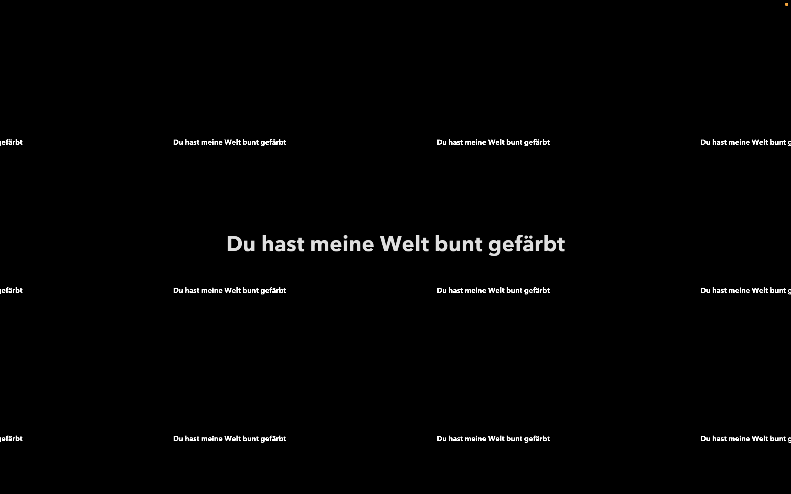
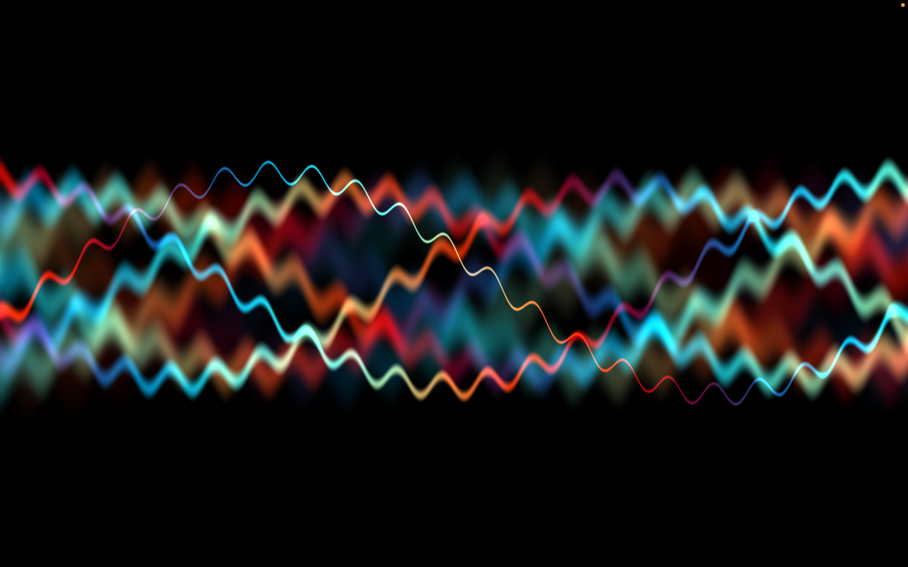
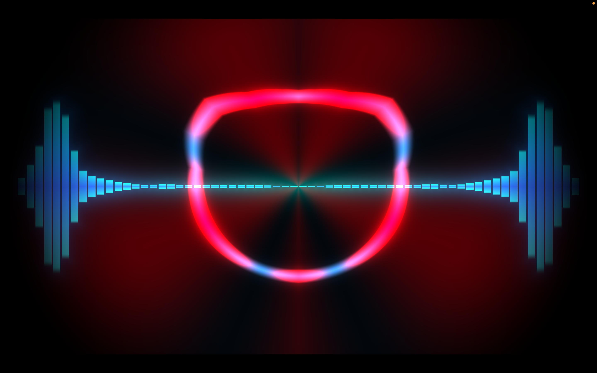
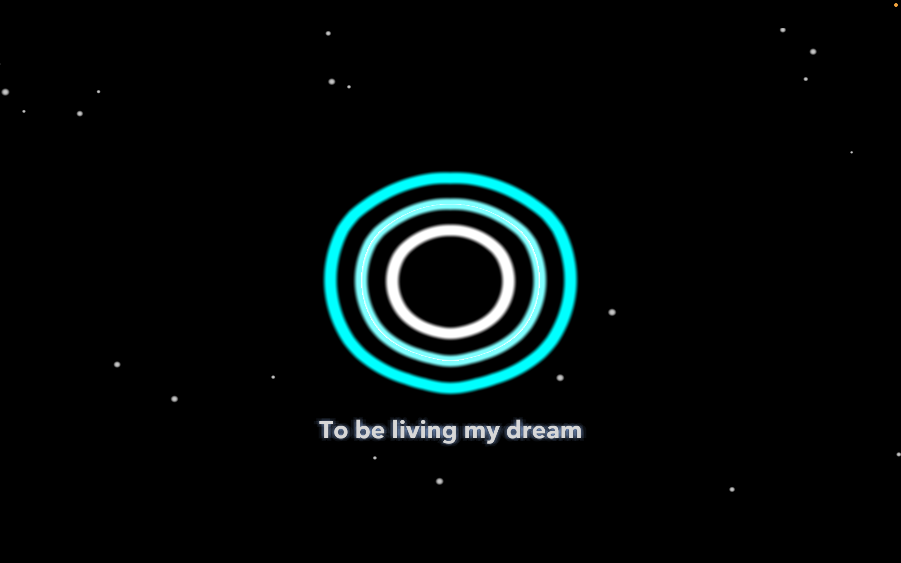

# Realtime customizable audiovisualizer
### MacOS optimized visualizer with Spotify integration and lyric fetching

Based on FFT analysis of the output audio multiple shaders can combine Song metadata and lyrics for nice procedual background visuals.

No paid APIs needed.

Lyric fetching with [lrclib](https://lrclib.net/) (and pylrc as backup).

Spotify login needed.

[Spotify api](https://developer.spotify.com/dashboard) is used for meta data fetching. Most funktionallity can be used without web api and only uses the [Spotify application sdk](https://gist.github.com/zfarbp/581ce7e50a1b5740b4d31f007cac87fb).

Shaders can be edited and added on the fly.

## Controlls:
Esc     - Close window
Q,E,1-9 - Switch shader
R       - Reload shader
A,D     - Adjust gain
S       - Reset gain
Y,C     - adjust FFT gain
X       - reset FFT gain
I       - Toggle info overlay
F       - Free audio source
Space   - Play/Pause
N       - Next song
J       - Set Jam url

# Credits:
waveLines.glsl adaptation of (Evesira)[https://www.shadertoy.com/view/tffSDr]

